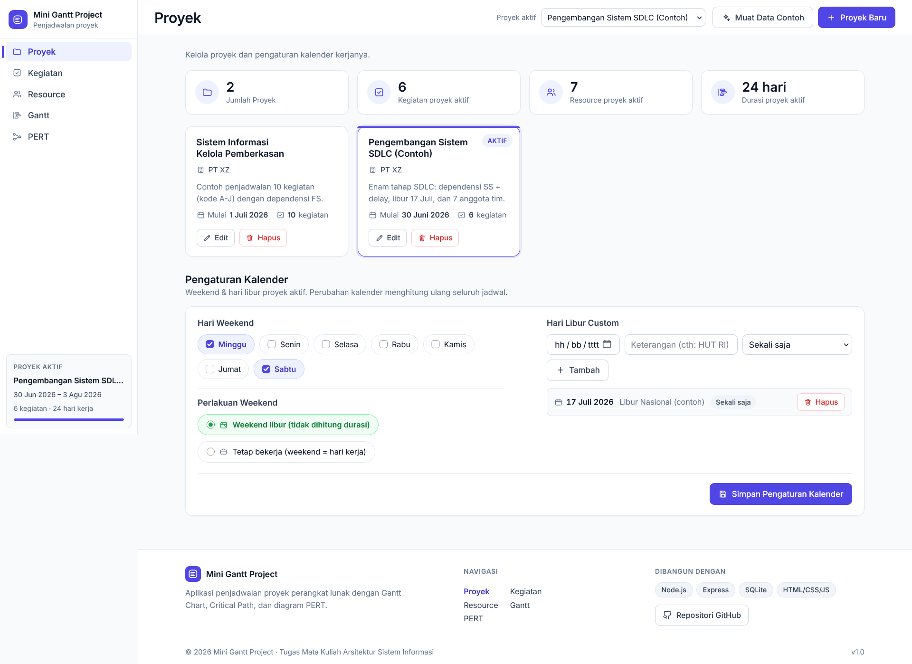
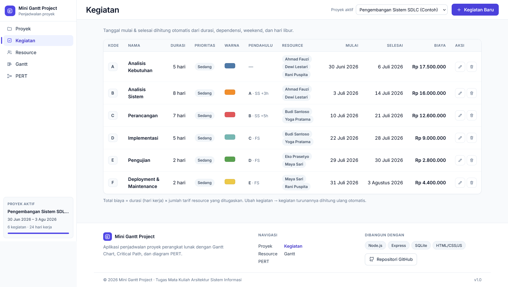
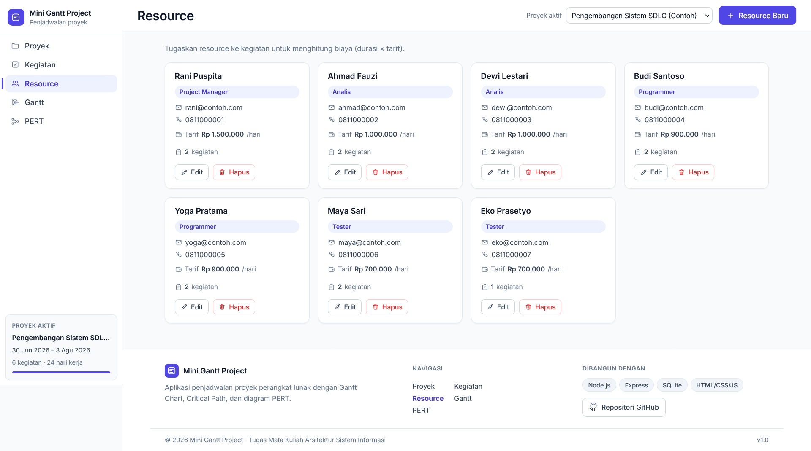
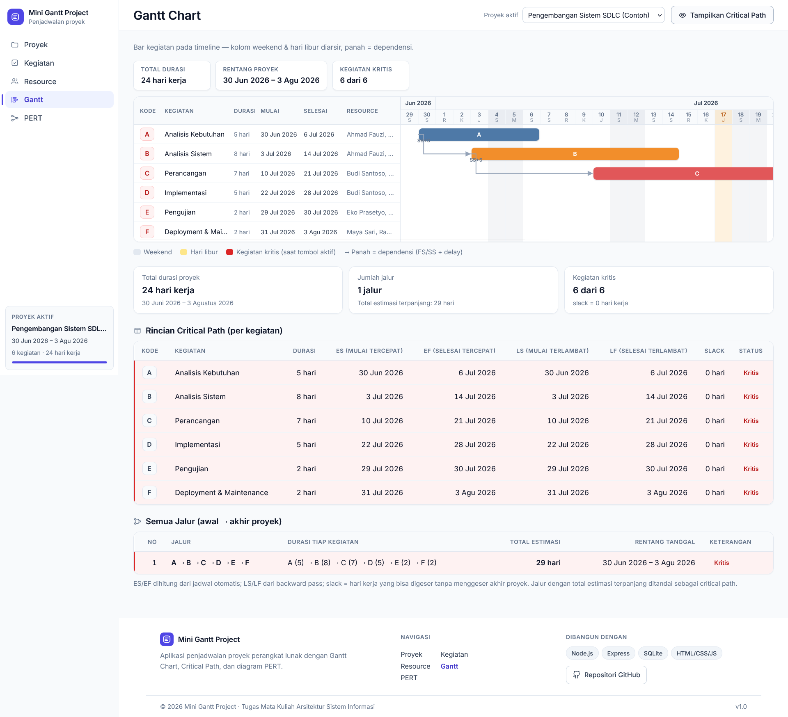
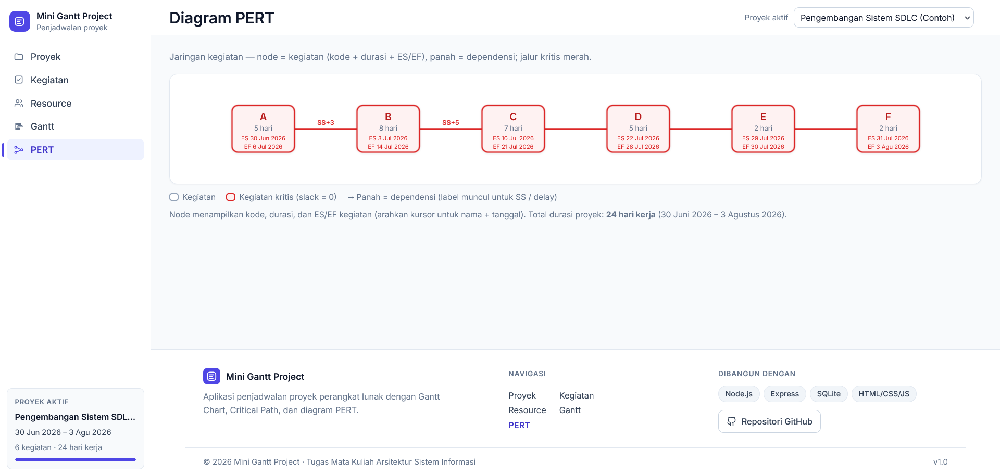

# 📅 Mini Gantt Project

Aplikasi web penjadwalan proyek pengembangan perangkat lunak sederhana — versi mini
alat seperti GanttProject. Buat proyek, atur kalender kerja (weekend & hari libur),
susun kegiatan dengan dependensi **FS/SS**, kelola resource/anggota tim, dan biarkan
tanggal mulai–selesai serta biaya **dihitung otomatis**.

Tampilan rapi, responsif, dan berbahasa Indonesia.

## ✨ Fitur

### 1. Proyek
- CRUD proyek: nama, organisasi, deskripsi, tanggal mulai.
- Pengaturan kalender per proyek:
  - Hari weekend yang bisa dicentang (Sabtu/Minggu, atau hari lain);
  - Pilihan **weekend libur** atau **weekend tetap bekerja**;
  - Hari libur custom: tanggal + keterangan, tipe **sekali (one-off)** atau
    **berulang tiap tahun (recurring)**.
- Perubahan kalender otomatis menghitung ulang seluruh jadwal kegiatan.

### 2. Kegiatan (Task)
- CRUD kegiatan: kode (A, B, C, …), nama, durasi (hari kerja), prioritas, warna bar.
- Dependensi: satu atau beberapa kegiatan pendahulu, masing-masing dengan
  **tipe FS (Finish-Start) / SS (Start-Start)** dan **delay (hari kerja)**.
- Tanggal mulai & selesai dihitung **otomatis** dari durasi, dependensi, weekend,
  dan hari libur — hari non-kerja dilewati dan tidak dihitung sebagai durasi.
  Dengan beberapa pendahulu, diambil tanggal mulai **paling akhir**.
- Jika sebuah kegiatan diubah, semua kegiatan turunannya dihitung ulang otomatis.
- Dependensi melingkar (circular) terdeteksi dan ditolak dengan pesan jelas.

### 3. Resource / Anggota Tim
- CRUD resource: nama, email, telepon, posisi (Project Manager, Analis,
  Programmer, Tester), tarif per hari, dan hari libur pribadi (opsional).
- Penugasan satu atau lebih resource ke tiap kegiatan.
- Nama resource tampil di baris kegiatan beserta **total biaya**
  (durasi × jumlah tarif resource yang ditugaskan).

> Peta jalan: Gantt chart, critical path, diagram PERT, dan data contoh
> dikerjakan pada tahap berikutnya (lihat [PROGRESS.md](PROGRESS.md)).

## 🛠 Tech Stack

| Bagian    | Teknologi                                             |
|-----------|-------------------------------------------------------|
| Backend   | Node.js + Express                                     |
| Database  | SQLite via `better-sqlite3` (sinkron, tanpa server)   |
| Frontend  | HTML + CSS + JavaScript murni (tanpa framework)       |
| Test      | `node:test` (bawaan Node.js)                          |

## 📁 Struktur Proyek

```
mini-gantt-project/
├── server/                  # Backend
│   ├── index.js             # Entry point (npm start)
│   ├── app.js               # Assembly Express + error handler
│   ├── db.js                # Koneksi & skema SQLite
│   ├── validate.js          # Validasi input (pesan Indonesia)
│   ├── logic/
│   │   ├── calendar.js      # Kalender kerja: weekend & hari libur
│   │   └── schedule.js      # Dependensi FS/SS, recalc, deteksi circular
│   └── routes/              # REST API (projects, tasks, resources)
├── public/                  # Frontend
│   ├── index.html
│   ├── css/styles.css
│   └── js/                  # api, app, projects, tasks, resources
├── tests/                   # Unit test (kalender & penjadwalan)
├── scripts/ui-smoke.js      # Smoke test UI opsional (Chrome headless)
├── docs/                    # Screenshot (lihat README ini)
├── data/                    # Database SQLite (dibuat otomatis, di-gitignore)
├── PROGRESS.md              # Checklist progres pengembangan
└── README.md
```

## 📦 Instalasi

Prasyarat: **Node.js 18+** (dikembangkan & diuji pada Node 24) dan npm.

```bash
# 1. Salin/clone proyek lalu masuk ke folder
cd SIMAPRO

# 2. Install dependensi
npm install
```

## ▶️ Menjalankan

```bash
npm start
```

Buka **http://localhost:3000** di browser.

- Port bisa diubah lewat environment variable, misal `PORT=8080 npm start`.
- File database dibuat otomatis di `data/mini-gantt.db` pada saat pertama dijalankan.

## 🧪 Menjalankan Test

```bash
npm test
```

Menjalankan unit test logika penjadwalan (kalender kerja, weekend & hari libur,
dependensi FS/SS + delay, perhitungan ulang otomatis, deteksi circular dependency)
menggunakan test runner bawaan Node.js.

Opsional — smoke test UI lewat Chrome headless (server harus sedang berjalan):

```bash
node scripts/ui-smoke.js
```

## 🌐 Ringkasan REST API

| Method | Endpoint                          | Fungsi                              |
|--------|-----------------------------------|-------------------------------------|
| GET    | `/api/projects`                   | Daftar proyek                       |
| POST   | `/api/projects`                   | Buat proyek                         |
| GET    | `/api/projects/:id`               | Detail proyek + kalender            |
| PUT    | `/api/projects/:id`               | Ubah proyek                         |
| DELETE | `/api/projects/:id`               | Hapus proyek                        |
| PUT    | `/api/projects/:id/calendar`      | Simpan weekend & hari libur (recalc)|
| GET    | `/api/projects/:id/tasks`         | Daftar kegiatan (+tanggal, biaya)   |
| POST   | `/api/projects/:id/tasks`         | Buat kegiatan (+dependensi)         |
| PUT    | `/api/tasks/:id`                  | Ubah kegiatan (recalc otomatis)      |
| DELETE | `/api/tasks/:id`                  | Hapus kegiatan                       |
| GET    | `/api/projects/:id/resources`     | Daftar resource                      |
| POST   | `/api/projects/:id/resources`     | Buat resource                        |
| PUT    | `/api/resources/:id`              | Ubah resource                        |
| DELETE | `/api/resources/:id`              | Hapus resource                       |

Contoh:

```bash
curl -X POST http://localhost:3000/api/projects \
  -H 'Content-Type: application/json' \
  -d '{"name":"Proyek Pertama","startDate":"2026-10-12"}'
```

## 📸 Screenshot

> Letakkan gambar-gambar berikut di folder [`docs/`](docs/) lalu bagian ini akan
> menampilkannya. (Belum ditambahkan — menunggu file screenshot.)

| Tampilan            | Gambar                          |
|---------------------|---------------------------------|
| Tampilan utama      |  |
| Manajemen proyek    |  |
| Manajemen kegiatan  |  |
| Manajemen resource  |  |
| Gantt chart         |  |
| Diagram PERT        |  |

## 📄 Lisensi

MIT
